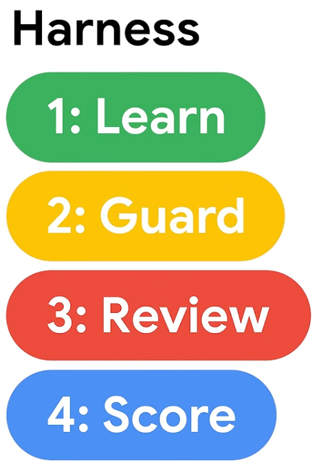
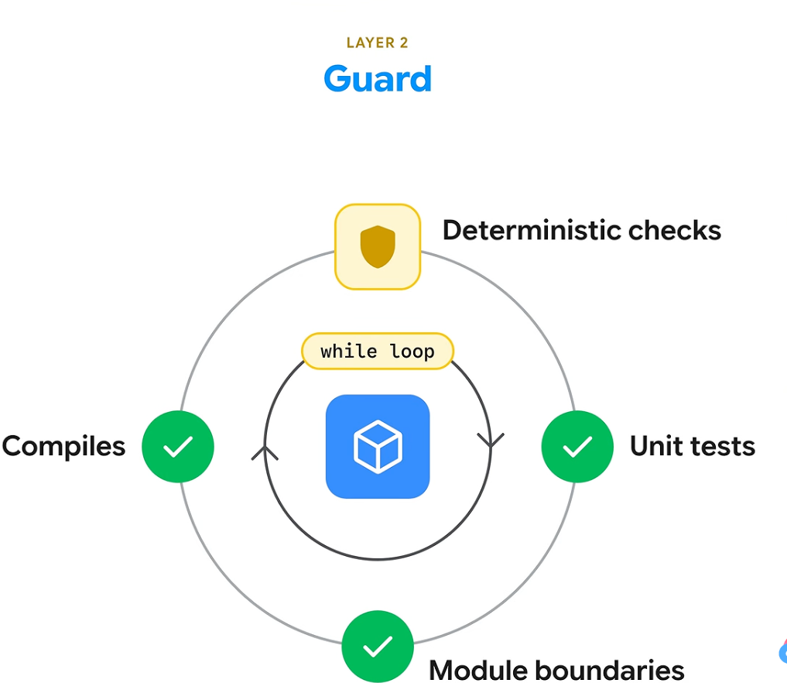
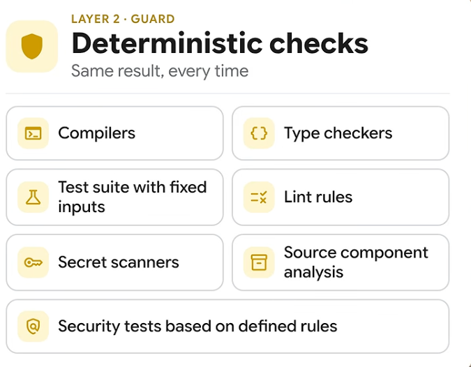

## 에이전트가 테스트를 통과했다고 하면 믿을 수 있을까?

에이전트가 실패한 테스트를 지워도 남은 테스트는 모두 통과할 수 있다. 그렇다면 통과했다는 보고를 받았을 때 어디를 확인해야 할까?

모델이 도구를 호출하고, 결과를 읽고, 다음 행동을 고르는 과정이 에이전트의 기본 루프다. 이 루프를 실행하고 관리하는 소프트웨어를 **하네스(harness)**라고 한다. 영상에서 로건은 하네스를 네 가지 역할로 나눴다. Learn은 작업에 필요한 정보를 제공하고, Guard는 코드로 규칙을 검사하며, Review는 변경이 의도에 맞는지 살핀다. 마지막 Score에서는 이 세 가지를 갖춘 하네스 자체가 얼마나 잘 작동하는지 평가한다. [영상 0:44 · 루프와 하네스](https://www.youtube.com/watch?v=BKVDdL1InsA&t=44s)

## Learn — 에이전트는 무엇을 먼저 읽어야 할까?

`AGENTS.md`에는 저장소 구조와 자세한 문서를 찾을 위치를 간단히 적는다. 실행이 끝나도 기억해야 할 결정과 다음 작업은 `plan.md` 같은 파일에 남긴다. 다음 실행에서는 이 파일을 읽고 앞선 작업을 이어 갈 수 있다.

특정 작업에만 필요한 지식은 스킬로 묶는다. 스킬은 `SKILL.md`에 지침을 적고 참고 자료와 스크립트를 함께 넣을 수 있는 폴더다. 영상에서는 에이전트가 이를 세 단계에 걸쳐 읽는 방식을 **점진적 공개(progressive disclosure)**라고 설명한다.

1. **탐색** 단계에서는 각 스킬의 이름과 짧은 설명을 읽어 어떤 작업에 쓸 수 있는지 파악한다.
2. **활성화** 단계에서는 지금 요청에 맞는 스킬을 골라 `SKILL.md` 본문의 지침을 읽는다.
3. **실행** 단계에서는 지침을 따르면서 해당 작업에 필요한 참고 파일을 열거나 스크립트를 실행한다.

이렇게 하면 Cloud Run에 배포할 때만 배포 지침이 컨텍스트에 들어온다. 팀에서 함께 쓰는 스킬과 도구는 플러그인 매니페스트로 묶어 배포할 수 있다. [영상 4:13 · 스킬의 구조와 로딩 순서](https://www.youtube.com/watch?v=BKVDdL1InsA&t=253s)

## Guard — 테스트를 통과한 이유까지 확인하기

처음의 질문으로 돌아가면 확인할 것이 세 가지다. 그 테스트가 수정 전에도 있었는지, 에이전트가 테스트의 검증 조건을 바꿨는지, 깨끗한 환경에서 다시 실행해도 통과하는지다. 영상에서는 새 테스트가 먼저 실패하는지 확인하고, 구현을 바꿔 통과시킨 뒤 리팩터링하는 과정을 작은 커밋 단위로 반복한다. Git 훅을 두면 커밋마다 테스트 파일의 변경도 검사할 수 있다.

같은 입력과 환경에서 같은 판정을 내리는 검사를 **결정론적 검사**라고 한다. 컴파일러와 타입 검사기, 고정 입력을 쓰는 단위 테스트, 린트가 여기에 해당한다. 모델을 다시 호출할 비용 없이 어떤 규칙이 어디서 깨졌는지 알 수 있다. 영상은 커밋에 비밀 값이 들어갔는지 검사하고, 정적 분석을 실행하며, 의존성 버전을 잠금 파일로 고정하고 알려진 취약점을 확인하는 예도 든다.

검사가 실패하면 에이전트에 오류 로그를 돌려준다. 영상의 예시는 세 번 시도해도 해결되지 않으면 사람이 로그를 보고 이어받도록 한다. 반복해서 나타나는 실패는 스킬에 반영해 다음 실행에도 남긴다. [영상 8:22 · 검사와 재시도](https://www.youtube.com/watch?v=BKVDdL1InsA&t=502s)

## Review — 큰 PR과 실제 화면을 어떻게 검토할까?

컴파일에 성공해도 화면 상단의 바가 점수를 가릴 수 있다. 코드 작성과 리뷰의 컨텍스트를 분리하면 리뷰 에이전트가 변경된 코드와 실행 화면을 새로 보고 사용자의 관점에서 문제를 찾을 수 있다.

큰 PR을 검토하는 시연에서는 먼저 변경의 목적을 요약하고 궁금한 파일을 하나씩 열어 봤다. **Repo Walkthrough**는 파일 사이의 관계를 그림으로 보여 주고 관련 코드 차이로 이동할 수 있게 한다. 화면 동작은 다른 방식으로 확인했다. 휴대폰·태블릿·데스크톱 크기에서 같은 게임을 실행해 녹화하고, 각 영상에서 발견한 문제를 한데 모았다. 하단 메뉴가 레이더를 가리는 문제는 수정 전후 화면을 나란히 놓았을 때 바로 보였다. UI는 이런 시각 자료로, CLI는 명령의 출력으로 확인하듯 검토할 증거도 프로그램에 맞춰 골라야 한다. [영상 16:36 · PR 시각화와 화면 QA](https://www.youtube.com/watch?v=BKVDdL1InsA&t=996s)

## Score — 하네스를 바꾼 뒤에도 같은 일을 해내는가?

팀원이 `AGENTS.md`를 수정하거나 모델을 교체하면 같은 요청에서도 에이전트의 행동이 달라질 수 있다. 영상은 환불 요청을 예로 들어 하네스를 평가하는 네 가지 방법을 보여 준다.

1. **도구 호출** — 환불 가능 여부를 먼저 확인했는지, 올바른 주문 번호를 전달했는지, 그 뒤에 환불 도구를 호출했는지 검사한다.
2. **결과와 경로** — 같은 환불을 처리해도 마지막 안내 문구는 달라질 수 있다. 답변의 의미가 맞는지와 실제로 어떤 순서로 도구를 호출했는지를 각각 확인한다.
3. **여러 차례의 대화** — 사용자가 앞서 말한 주문 번호를 다음 메시지에서 정정하면, 정정한 번호로 처리하는지 확인한다.
4. **작업 인계** — 환불 담당 에이전트에게 요청이 전달됐는지, 그 에이전트가 처리에 필요한 주문 정보를 함께 받았는지 확인한다.

이제 “테스트가 통과했다”는 보고를 읽으면 먼저 무엇을 실행했고 무엇이 바뀌었는지 살펴볼 수 있다. 하네스를 고친 뒤에는 같은 환불 사례를 다시 실행해, 이전에 지키던 호출 순서와 인계 정보가 여전히 보존되는지도 확인할 수 있다. [영상 22:45 · 에이전트 평가의 네 가지 패턴](https://www.youtube.com/watch?v=BKVDdL1InsA&t=1365s)
