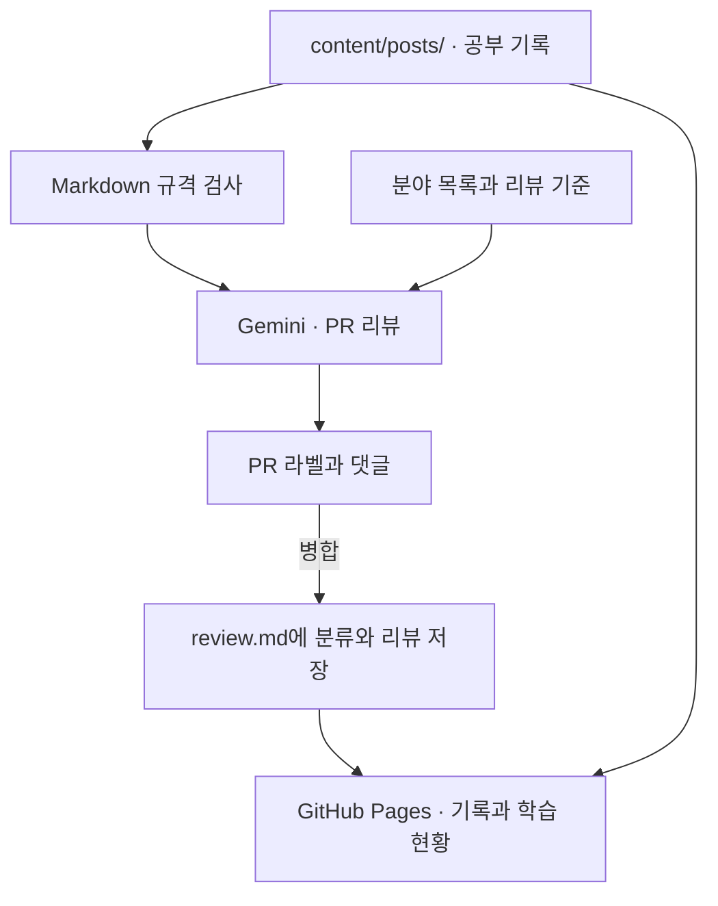

# 공부 기록 작성과 운영

## 새 글 만들기

`pnpm new "브라우저 캐시 이해하기"`를 실행하면 한국 시간 기준 오늘 날짜 아래 다음 번호 폴더에 제목이 채워진 `title.md`와 `assets/`가 생긴다. `pnpm new`만 입력하면 제목을 물어본다. 같은 날 두 번 실행하면 각각 `01/title.md`와 `02/title.md`가 생긴다. 제목이 같아도 별개의 글이다. 요약과 본문을 채운 뒤 `pnpm lint:notes`로 확인한다.

## 로컬 편집기로 쓰기

Node.js 24에서 처음 한 번 `pnpm install --frozen-lockfile`를 실행한 뒤 `pnpm dev`로 사이트를 연다. 상단 **글쓰기** 메뉴에서 날짜를 선택한 뒤 **기록 선택**에서 기존 글의 번호와 제목을 고르거나 **새 글 쓰기**를 고른다. 왼쪽에서 제목·요약·Markdown 본문을 쓰면 오른쪽에서 미리 볼 수 있다.

사진을 왼쪽 Markdown에 끌어놓으면 `content/posts/YYYY-MM-DD/NN/assets/`에 복사하고 마우스를 놓은 위치에 이미지를 삽입한다. 대표 사진은 상단 YAML을 닫는 `---` 다음 첫 문단에 한 장만 놓는다. 본문 중간에 놓은 사진은 해당 위치에 표시된다. 대괄호 안의 사진 설명은 자유롭게 바꿀 수 있다. **파일 저장**을 누르면 규격을 검사하고 `content/posts/YYYY-MM-DD/NN/title.md`에 저장한다. 이후 글과 이미지를 함께 커밋한다.

### 저장한 글로 리뷰 받기

1. 로컬 저장을 마치면 글과 첨부 이미지가 작업 폴더에 생긴다. 최신 `main`을 기준으로 만든 작업 브랜치에서 `git status --short`로 경로를 확인한다.
2. 해당 날짜의 글과 첨부 이미지만 커밋해 브랜치를 푸시한다. GitHub에서 대상 브랜치를 `main`으로 선택해 PR을 연다.
3. 아티클메이트의 첫 리뷰가 달리면 PR **Conversation** 탭에서 새 댓글로 `/답변 내용`을 쓴다. 답변을 받은 뒤 같은 방법으로 대화를 이어 간다.
4. 남기고 싶은 마지막 응답까지 받은 뒤 새 댓글에 `/마무리` 한 줄을 쓴다. 종료 확인 댓글을 보고 직접 병합한다.
5. 병합 후 **공부 일지 Pages 배포** 작업이 리뷰·대화·README 목차를 한 커밋에 저장하고 그 상태를 배포한다.

### 커밋 제목

| 변경 | 형식 | 예시 |
| --- | --- | --- |
| 공부 글과 첨부 이미지 | `docs: '글 제목'` | `docs: 'HTTP 캐시와 요청 중복을 구분하기'` |
| 가이드, 목차, 게시된 리뷰 | `docs: '문서 변경 제목'` | `docs: '공부 기록 목차 갱신'` |
| 빌드, 배포, 편집기, 자동화 환경 | `chore: 변경 내용` | `chore: TIL 환경세팅` |

공부 글의 커밋 제목은 Markdown 상단의 `title`을 작은따옴표로 감싼다. 사진은 해당 글과 같은 커밋에 담는다. 환경 조정 중에 만든 작업 커밋은 하나로 합친다. 첫 환경 세팅의 프로젝트 버전은 `package.json`에 `1.0.0`으로 기록한다.

## 오늘 기록 쓰기

1. [템플릿](daily.md)을 `content/posts/YYYY-MM-DD/NN/title.md`로 복사한다. 날짜는 한국 시간 기준이며 `NN`은 그날의 글 번호다. 첫 글은 `01`로 시작하며 다음 글마다 번호를 올린다. 기존에 날짜 바로 아래에 둔 `title.md`도 계속 읽을 수 있다.
2. 템플릿의 제목, 한 줄 요약, 본문은 작성 예시다. 실제 공부한 내용으로 바꿔 쓴다. 무엇을 공부했고 어떻게 생각했는지 적는다. 직접 비교해 본 코드나 관찰 결과가 있으면 함께 남긴다.
3. `pnpm lint:notes`로 확인하고 글을 PR에 올린다. Gemini가 분야·주제 라벨과 리뷰 댓글을 달고, 병합 후 리뷰가 사이트에도 반영된다.

```markdown
---
title: "ETag가 줄여 주는 것"
summary: "304 응답에서 네트워크 요청과 본문 전송을 구분했다."
level: 표준 # 기초 / 표준 / 전문
---

개발자 도구에서 같은 리소스를 두 번 요청했다. 두 번째 요청에는
If-None-Match가 들어갔고 응답은 304였다. 요청은 발생했지만 본문 전송은 줄었다.
```

### 글에 사진 넣기

사진은 글과 같은 폴더의 `assets/`에 둔다. 예를 들어 `content/posts/2026-11-18/01/assets/cache-flow.webp`를 저장한 뒤, 같은 날 글의 YAML을 닫는 `---` 바로 아래 첫 문단에 적는다.

```markdown


## 배운 점
```

첫 문단에 이미지 한 장만 넣으면 최신 글의 표지로도 사용한다. 표지를 생략하면 최신 글 카드에 제목과 요약만 표시한다. 본문 중간에도 같은 경로 형식으로 이미지를 넣을 수 있다. 글 파일과 이미지 파일을 함께 올린다. 파일 형식은 WebP, PNG, JPEG 등을 사용할 수 있다.

GitHub에 첨부된 이미지라면 저장소에 복사하지 않고 ``처럼 HTTPS 주소를 사용할 수 있다.

### 게시글 본문과 목차

본문에는 Markdown 제목, 강조, 목록, 인용문, 링크, 이미지, 표와 코드 블록을 쓸 수 있다. `##`와 `###`로 문단 제목을 쓰면 목차가 자동으로 생긴다. 데스크톱에서는 본문 오른쪽에서, 모바일에서는 글 상단의 **이 글의 목차**를 펼쳐 이동한다.

아래는 한 줄 안에 코드와 백틱 문자를 쓰는 예, 그리고 여러 줄의 코드를 쓰는 예다. 코드 블록의 여는 줄에 언어를 적으면 해당 문법에 맞춰 색상이 표시된다.

~~~~markdown
본문에서 `useEffect`를 언급하거나, 백틱을 포함한 코드 `` `name` ``를 쓸 수 있다.

```js
const label = `Hello, ${name}`;
```
~~~~

Mermaid와 수식은 별도의 렌더러를 사용하지 않는다.

### Markdown 규격과 린트

| 항목 | 검사 기준 |
| --- | --- |
| 경로 | `content/posts/YYYY-MM-DD/NN/title.md` 형식과 실제 달력 날짜 |
| 난이도 | `level`은 선택 항목이다. 개념 입문은 `기초`, 일반적인 적용은 `표준`, 심화 분석은 `전문`으로 적는다. 생략하면 난이도 표시를 숨긴다. |
| 상단 YAML | `---`로 여닫고 `title`, `summary`에 비어 있지 않은 문자열 작성 |
| 본문 | 제목·표지·안내 주석 외에 공부한 내용이 한 줄 이상 필요 |
| 첫 문단 표지 | 사진 설명과 HTTPS 주소 또는 실제로 존재하는 `./assets/` 파일 경로 |
| 선택 필드 | `example`은 불리언. `review_thread`는 `role`과 `text`를 가진 배열. 기존 글의 `learning`은 등록된 `category`와 `topic`을 가진 배열 |

전체 검사와 글 하나 검사는 각각 아래처럼 실행한다. 오류 메시지에 파일명과 고칠 항목이 표시된다. PR과 `main` 푸시에서도 **TIL Markdown lint**가 실행된다. 이 검사는 PR의 Checks 탭에서 확인한다.

```sh
pnpm lint:notes
pnpm lint:notes content/posts/2026-11-18/01/title.md
```

## PR 자동 리뷰

[분야별 범위](../content/categories.yml)와 [분류·리뷰 기준](study-review.md)이 Gemini와 작성 보조 도구가 함께 읽는 원본이다. 분야를 추가하거나 판단 기준을 바꿀 때 이 파일들을 수정한다.

| 시점 | 동작 |
| --- | --- |
| PR 작성·수정 | 변경된 공부 글의 규격을 먼저 검사한다. 통과하면 각 본문과 기존 주제 이름을 Gemini에 보낸다. PR의 글들을 합쳐 `분야/web`, `주제/ETag 재검증` 같은 라벨을 달고 하나의 댓글에 글별 리뷰를 남긴다. 새 커밋은 같은 댓글을 갱신한다. |
| 병합 | 병합된 파일과 PR에서 검토한 파일이 일치하면 같은 결과를 재사용한다. 병합 충돌 해결 등으로 내용이 달라졌거나 완료된 리뷰가 없으면 병합된 글로 리뷰한다. Actions가 글과 같은 폴더의 `review.md`에 분류, 태그와 첫 리뷰를 저장하고 Pages를 갱신한다. |
| 사이트 | 생성된 분야로 기록을 집계하고 주제 태그로 검색한다. 상세 화면에 첫 리포트를 표시한다. 여러 분야에 해당하는 글도 전체 기록에서는 한 편이다. |

**한 번만 설정** — [Google AI Studio](https://aistudio.google.com/api-keys)에서 Gemini API 키를 발급하고 [저장소 Actions secrets](https://github.com/dhyun2/TIL/settings/secrets/actions/new)에 `GEMINI_API_KEY`로 등록한다. GitHub 작업에는 Actions 기본 토큰을 쓴다. 게시 작업은 `main`에 결과 파일을 커밋할 수 있는 권한과 GitHub Actions 방식의 Pages 배포를 사용한다. 학습 대화는 개인 저장소 소유자의 PR 댓글에서 동작한다. `main`에 글을 직접 올리면 린트, 목차 갱신, 사이트 배포가 실행된다. 무료 티어 조건과 한도는 [Google 요금표](https://ai.google.dev/gemini-api/docs/pricing)에서 확인할 수 있다.

### PR에서 대화 마무리하기

첫 리뷰의 점검 질문에 답하려면 PR의 **Conversation** 탭에서 저장소 소유자 계정으로 새 댓글을 작성한다. 각 명령은 댓글의 첫 글자부터 쓴다.

| 댓글 예시 | 결과 |
| --- | --- |
| `/답변 304여도 재검증 요청은 보내고 응답 본문을 재사용해요.` | 글이 한 편이면 바로 연결한다. Gemini가 글, 첫 리뷰, 이 글에서 앞서 나눈 대화를 읽고 새 댓글로 답한다. 같은 방식으로 계속 대화할 수 있다. |
| `/답변 2026-11-18/01 응답이 아직 신선하면 어떻게 되나요?` | 여러 편을 함께 올린 PR에서 날짜와 번호가 일치하는 글에 연결한다. |
| `/마무리` | 이 한 줄로 PR 전체의 학습 대화를 끝낸다. 종료 확인 댓글이 달리고 추가 학습 답변은 멈춘다. |

**직접 병합하면** Actions가 마무리 전까지 작성한 답변과 실제로 달린 Gemini 답변을 같은 폴더에 있는 `review.md`의 `review_thread`에 순서대로 이어 쓴다. 첫 리뷰는 `review.md` 본문에 보관한다. 공부 기록 사이트의 **이어진 대화**에도 같은 내용이 표시된다.

일반 작업 댓글, 다른 사람의 댓글, 종료 명령은 학습 기록에서 제외한다. AI의 마지막 답변까지 담고 싶으면 그 댓글을 받은 뒤 마무리한다. 마무리 신호 없이 병합하면 기존처럼 첫 리뷰만 자동 게시되고 PR 대화는 GitHub에 남는다.

README의 **공부 기록** 목차는 글이 `main`에 반영될 때 날짜와 제목으로 자동 갱신된다.

## 프로젝트 구조



| 위치 | 역할 |
| --- | --- |
| `docs/daily.md`, `content/posts/` | 작성 양식과 날짜별 원문 |
| `libs/journal/read-note.js` | 로컬과 CI에서 공유하는 Markdown 검사 |
| `content/categories.yml`, `docs/study-review.md` | 분야 이름과 범위, 태그·리뷰 판단 기준 |
| `.github/workflows/`, `apps/reviewer/` | PR 검사와 리뷰, 병합한 결과 게시 |
| `src/`, `astro.config.mjs` | [뷰어 구조와 로컬 실행](viewer.md) |


### 자동화 코드를 찾을 때

| GitHub에서 일어난 일 | 실행되는 JavaScript |
| --- | --- |
| PR에 글을 올리거나 수정함 | [create-report.js](../apps/reviewer/create-report.js)에서 글을 검사하고 첫 리뷰와 라벨을 갱신한다. |
| 작성자가 `/답변`, `/마무리` 댓글을 남김 | [reply.js](../apps/reviewer/reply.js)에서 글별 대화에 답하거나 종료를 확인한다. |
| PR을 병합함 | [publish.js](../apps/reviewer/publish.js)에서 리뷰 결과와 마무리된 대화를 저장한다. |

리뷰 기준은 [study-review.md](study-review.md), 분야 이름은 [categories.yml](../content/categories.yml)에서 수정한다. 모델을 변경하려면 저장소 Actions 변수 `GEMINI_MODEL`에 사용할 모델 ID를 설정한다.
